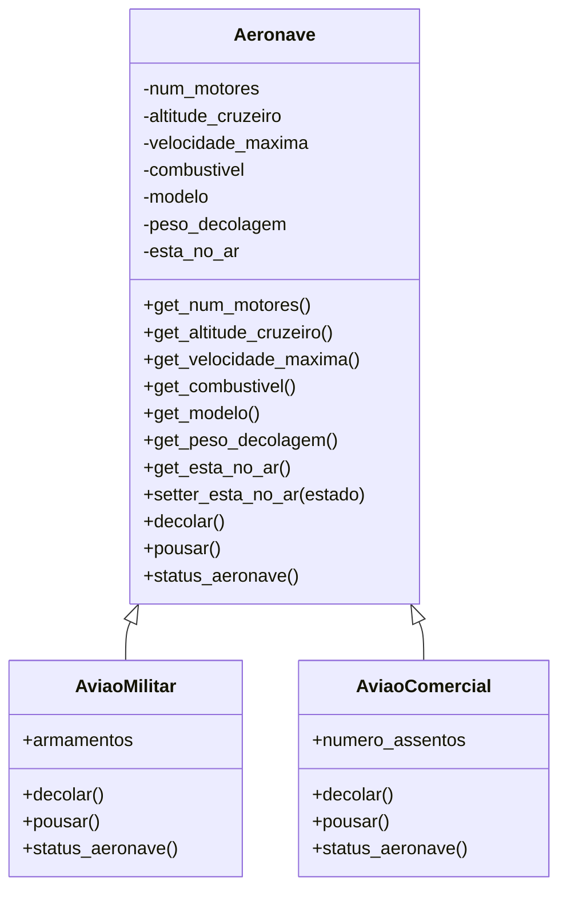

# Simulador de Aeronaves — Programação Orientada a Objetos

Projeto acadêmico desenvolvido em Python para praticar os fundamentos de **Programação Orientada a Objetos (POO)** por meio de um simulador de operações de aeronaves. O programa permite cadastrar aeronaves militares e comerciais, consultar seus painéis de status e executar simulações textuais de decolagem e pouso pelo terminal.

## Integrantes

- **Lucas Helou Perine**
- **Victor Rodrigues Ferreira**

> **Escopo atual:** a implementação funcional está em Python. O arquivo C++ presente no repositório está vazio e não contém uma segunda versão do sistema.

## Funcionalidades

- Cadastro de aeronaves militares, com dados gerais e uma lista de itens de armamento informados pelo usuário.
- Cadastro de aeronaves comerciais, incluindo o número de assentos.
- Validação básica dos dados digitados durante o cadastro.
- Consulta do painel de status de todas as aeronaves cadastradas.
- Simulação textual de decolagem e pouso, com mensagens de etapas e pausas entre elas.
- Controle simplificado da situação da aeronave, indicando se ela está no ar ou no solo.
- Tratamento de algumas situações inválidas, como tentar decolar uma aeronave que já está no ar ou pousar uma que já está no solo.

As simulações são executadas no terminal. Não há controle real de aeronaves, conexão com sistemas externos ou interface gráfica.

## Tecnologias utilizadas

- **Python** — linguagem principal do projeto.
- **Biblioteca padrão `time`** — utilizada para inserir pausas entre as mensagens das simulações.
- **Módulo `abc`** — importado no código para utilizar o decorador `abstractmethod`.
- **Terminal / linha de comando** — interface de interação com o usuário.

O código não utiliza dependências externas que precisem ser instaladas com `pip`.

## Estrutura do repositório

```text
POO-2026-LucasPerine-VictorRodrigues/
├── Projeto-final/
│   ├── C++/
│   │   └── aeroporto.cpp
│   └── Python/
│       └── Aeronaves.py
└── README.md
```

- `Projeto-final/Python/Aeronaves.py`: contém as classes, as funções de cadastro, o menu e a execução principal do simulador.
- `Projeto-final/C++/aeroporto.cpp`: arquivo reservado para uma possível implementação em C++; atualmente está vazio.

## Organização orientada a objetos

O código utiliza uma classe-base chamada `Aeronave` e duas classes especializadas que herdam dela.



### `Aeronave`

É a classe-base que reúne os dados comuns às aeronaves:

- modelo;
- quantidade de motores;
- altitude de cruzeiro;
- velocidade máxima;
- combustível;
- peso de decolagem;
- situação atual (`esta_no_ar`).

Os atributos comuns são declarados com dois underscores no início do nome, seguindo a convenção de encapsulamento do Python. O acesso a esses dados é feito por métodos getters. O método `setter_esta_no_ar()` altera a situação da aeronave e impede que o mesmo estado seja definido novamente.

### `AviaoMilitar`

Herda os atributos e métodos da classe `Aeronave` e acrescenta uma lista de itens de armamento informados durante o cadastro. Sobrescreve os métodos `decolar()`, `pousar()` e `status_aeronave()` para apresentar mensagens e etapas próprias da simulação militar.

### `AviaoComercial`

Também herda de `Aeronave` e acrescenta o atributo `numero_assentos`. Sobrescreve os métodos `decolar()`, `pousar()` e `status_aeronave()` para apresentar as etapas da simulação comercial, incluindo informações relacionadas à cabine e aos passageiros.

## Conceitos de POO presentes no projeto

| Conceito | Como aparece no código |
|---|---|
| **Herança** | `AviaoMilitar` e `AviaoComercial` herdam de `Aeronave` por meio de `class AviaoMilitar(Aeronave)` e `class AviaoComercial(Aeronave)`. |
| **Encapsulamento** | Os atributos comuns da classe-base utilizam nomes iniciados por `__`, e seus valores são consultados por getters. |
| **Polimorfismo** | As duas subclasses implementam suas próprias versões de `decolar()`, `pousar()` e `status_aeronave()`. A função chamada depende do tipo de objeto. |
| **Abstração (intenção no código)** | Os métodos principais da classe-base são decorados com `@abstractmethod`, indicando que devem ter implementações nas subclasses. Há uma observação técnica sobre isso na seção de limitações. |

## Como executar

### Pré-requisitos

- Python instalado no computador.
- Acesso a um terminal, Prompt de Comando ou PowerShell.

### Passos

1. Baixe o repositório pelo GitHub ou clone-o:

   ```bash
   git clone https://github.com/LucasPerine93/POO-2026-LucasPerine-VictorRodrigues.git
   ```

2. Entre na pasta do projeto:

   ```bash
   cd POO-2026-LucasPerine-VictorRodrigues
   ```

3. Execute o arquivo Python:

   **Windows (Python Launcher):**

   ```bash
   py "Projeto-final/Python/Aeronaves.py"
   ```

   **Linux, macOS ou Windows com o comando `python`:**

   ```bash
   python "Projeto-final/Python/Aeronaves.py"
   ```

Não é necessário instalar bibliotecas adicionais.

## Como utilizar o programa

Ao iniciar, o sistema apresenta um menu com as seguintes opções:

| Opção | Ação |
|---|---|
| `0` | Encerrar o programa. |
| `1` | Cadastrar uma aeronave militar. |
| `2` | Cadastrar uma aeronave comercial. |
| `3` | Exibir o painel de status das aeronaves cadastradas. |
| `4` | Executar a simulação de decolagem de todas as aeronaves cadastradas. |
| `5` | Executar a simulação de pouso de todas as aeronaves cadastradas. |

### Cadastro de aeronave militar

O programa solicita os dados gerais da aeronave e, em seguida, permite informar os itens de armamento que serão exibidos no painel. Para encerrar a entrada dessa lista, o sistema solicita a palavra `parar`.

### Cadastro de aeronave comercial

O cadastro solicita os dados gerais da aeronave e a quantidade de assentos.

### Status, decolagem e pouso

As opções de status percorrem a lista de aeronaves cadastradas e chamam `status_aeronave()` para cada objeto. As opções de decolagem e pouso fazem o mesmo com os métodos `decolar()` e `pousar()`. Como cada subclasse sobrescreve esses métodos, as mensagens exibidas variam conforme o tipo de aeronave.

As aeronaves são mantidas em uma lista chamada `avioes` enquanto o programa está em execução. Ao encerrar o programa, os cadastros são perdidos.

## Limitações conhecidas da versão atual

Esta documentação descreve o comportamento encontrado no código do repositório. Alguns pontos ainda podem ser aprimorados:

- **Sem persistência de dados:** não há banco de dados nem gravação em arquivos. Os cadastros existem apenas durante a execução.
- **Sem gestão de voos ou passageiros:** o projeto atual trabalha com cadastro e simulação de aeronaves; não implementa as classes `Aeroporto`, `Voo` ou `Passageiro` descritas em versões anteriores da documentação.
- **Arquivo C++ vazio:** `Projeto-final/C++/aeroporto.cpp` ainda não possui implementação.
- **Classe abstrata:** `Aeronave` utiliza `@abstractmethod`, mas não herda de `ABC`. Portanto, o Python não aplica integralmente a restrição de classe abstrata nesse estado.
- **Entrada inválida no menu:** após uma entrada que não pode ser convertida para inteiro, o fluxo do menu pode continuar usando uma variável que não foi definida na iteração atual.
- **Validação da velocidade comercial:** a condição atual de validação contém uma comparação lógica que não representa corretamente o intervalo descrito na mensagem de erro.
- **Lista de armamentos:** a palavra usada para encerrar a entrada (`parar`) também é adicionada à lista antes do fim do cadastro.
- **Dados simplificados:** alguns valores são recebidos como texto e convertidos durante os cálculos. O status é representado apenas pelo indicador `esta_no_ar`, sem persistência ou controle operacional completo.

## Possíveis melhorias futuras

- Corrigir e centralizar as validações de entrada.
- Fazer `Aeronave` herdar corretamente de `ABC` ou ajustar a abstração pretendida.
- Melhorar o controle de erros do menu.
- Impedir que a palavra de encerramento seja adicionada à lista de armamentos.
- Separar o menu, as classes e as validações em módulos distintos.
- Adicionar testes automatizados.
- Implementar persistência de dados, caso faça parte dos próximos objetivos do projeto.
- Desenvolver a versão C++, se isso estiver previsto no escopo.

## Contexto acadêmico

Repositório de atividade de **Programação Orientada a Objetos (POO)**, com foco na aplicação de classes, herança, encapsulamento, abstração e polimorfismo em Python.

**Repositório:** [POO-2026-LucasPerine-VictorRodrigues](https://github.com/LucasPerine93/POO-2026-LucasPerine-VictorRodrigues)
