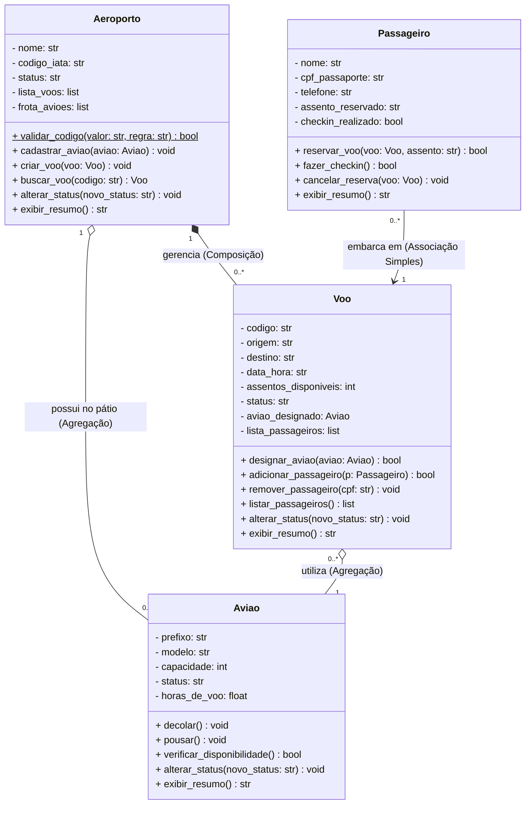

# ✈️ CODE PLAN: Sistema de Gestão de Aeroporto (POO)

Este documento descreve a arquitetura orientada a objetos, o mapeamento de relacionamentos UML e as regras de negócio para a implementação dos métodos (exclusivos, estáticos e polimórficos/sobrescritos) do sistema de gerenciamento de aeroporto via linha de comando (CMD).

---

## 1. Diagrama de Classes UML (Mermaid)

O diagrama abaixo representa a estrutura oficial modelada no **draw.io**, contendo as 4 classes do escopo, suas visibilidades (`-` privado, `+` público), métodos estáticos (`$`) e cardinalidades.

---

## 2. Mapeamento de Ligações e Relacionamentos

Abaixo está o guia de como as classes se conectam e como essas conexões devem se comportar quando forem transformadas em código:

### 2.1. Composição (`◆───`) | `Aeroporto` (1) $\rightarrow$ `Voo` (0..*)
* **Conceito:** Relação Todo/Parte forte. O `Voo` não existe no sistema fora do contexto do `Aeroporto`.
* **Comportamento na Arquitetura:** A classe `Aeroporto` armazena as instâncias de `Voo` no atributo privado `- lista_voos: list`. Se o objeto `Aeroporto` for reiniciado ou encerrado no CMD, toda a malha de voos associada a ele deixa de existir.

### 2.2. Agregação (`◇───`) | `Aeroporto` (1) $\rightarrow$ `Aviao` (0..*)
* **Conceito:** Relação Todo/Parte fraca. A parte (`Aviao`) sobrevive sem o todo (`Aeroporto`).
* **Comportamento na Arquitetura:** O `Aviao` pode ser instanciado separadamente e depois adicionado à `- frota_avioes: list` do aeroporto através do método `cadastrar_aviao()`.

### 2.3. Agregação (`◇───`) | `Voo` (0..*) $\rightarrow$ `Aviao` (1)
* **Conceito:** Um voo precisa de um avião para acontecer, mas se o voo for cancelado ou concluído, o avião continua existindo intacto para realizar outros voos.
* **Comportamento na Arquitetura:** O método `designar_aviao(aviao: Aviao)` dentro de `Voo` recebe a referência de um objeto `Aviao` já existente no pátio e o vincula ao atributo `- aviao_designado: Aviao`.

### 2.4. Associação Simples (`───>`) | `Passageiro` (0..*) $\rightarrow$ `Voo` (1)
* **Conceito:** Conexão direta de uso entre dois objetos independentes.
* **Comportamento na Arquitetura:** O `Passageiro` não pertence exclusivamente à estrutura física do `Aeroporto`, mas interage diretamente com um `Voo`. Ao chamar `reservar_voo(voo: Voo, assento: str)`, o passageiro solicita sua inclusão na `- lista_passageiros: list` daquele voo específico.

---

## 3. Regras de Métodos: Escrita, Sobrescrita e Estáticos

Para garantir a padronização, o polimorfismo e a segurança da arquitetura, os métodos estão divididos em 4 categorias de comportamento:

### 3.1. Método Estático da Classe Mãe (`$`)
Pertence diretamente à classe `Aeroporto` (não exige instanciar um objeto para ser chamado) e serve como utilitário global para ser configurado pelas classes filhas/componentes:

| Método | Onde é definido | Como as outras classes o configuram/utilizam |
| :--- | :--- | :--- |
| **`+ validar_codigo(valor: str, regra: str): bool`** | `Aeroporto` | • **`Aviao`:** Chama passando a regra `"PREFIXO"` para validar se o prefixo segue o padrão aeronáutico (ex: `PT-XYZ`). • **`Voo`:** Chama passando a regra `"CODIGO_VOO"` para validar o formato de identificação (ex: `AD1234`). • **`Passageiro`:** Chama passando a regra `"DOCUMENTO"` para validar a quantidade de dígitos do CPF ou Passaporte antes de concluir o cadastro. |

---

### 3.2. Métodos Exclusivos da Classe Mãe (Proibida a Sobrescrita)
Estes métodos gerenciam a orquestração geral do sistema pelo menu do CMD. **Nenhuma outra classe deve possuir ou sobrescrever métodos com estas assinaturas:**

* **`+ cadastrar_aviao(aviao: Aviao): void`**
  * *Regra:* Verifica se o prefixo do avião é válido (usando o método estático) e o insere na `- frota_avioes`.
* **`+ criar_voo(voo: Voo): void`**
  * *Regra:* Registra um novo voo na `- lista_voos` do aeroporto.
* **`+ buscar_voo(codigo: str): Voo`**
  * *Regra:* Percorre a `- lista_voos` procurando pelo código informado no CMD e retorna o objeto `Voo` correspondente (ou nulo/erro caso não encontre).

---

### 3.3. Métodos Polimórficos (Sobrescrita Obrigatória / Override)
Estes métodos possuem a **mesma assinatura** na classe `Aeroporto` e nas classes filhas/componentes, mas **cada classe reescreve (sobrescreve) o comportamento interno** de acordo com o seu contexto:

#### A. `+ exibir_resumo(): str`
* **Em `Aeroporto` (Comportamento Base):** Retorna o cabeçalho do sistema no CMD (Nome do Aeroporto, Código IATA, Status da Pista, total de aviões no pátio e total de voos agendados).
* **Em `Aviao` (Sobrescrito):** Retorna uma linha formatada com os dados técnicos da aeronave (`[Prefixo] Modelo | Capacidade: X | Status: Y | Horas de Voo: Z`).
* **Em `Voo` (Sobrescrito):** Retorna os detalhes operacionais do painel de embarque (`Voo [Código]: Origem -> Destino | Data/Hora | Assentos Livres: X | Status: Y`).
* **Em `Passageiro` (Sobrescrito):** Substitui a antiga ficha individual, retornando o cartão de embarque (`Passageiro: Nome | Doc: CPF | Assento: X | Check-in: Sim/Não`).

#### B. `+ alterar_status(novo_status: str): void`
* **Em `Aeroporto` (Comportamento Base):** Altera a operação geral do terminal (ex: `"Operacional"`, `"Fechado por Mau Tempo"`, `"Emergência"`).
* **Em `Aviao` (Sobrescrito):** Altera o estado da máquina (ex: `"Disponível"`, `"Em Voo"`, `"Em Manutenção"`). Substitui métodos isolados de manutenção, centralizando a mudança de estado.
* **Em `Voo` (Sobrescrito):** Altera a situação da viagem (ex: `"Confirmado"`, `"Embarcando"`, `"Atrasado"`, `"Cancelado"`). Se o status mudar para `"Cancelado"`, deve liberar o avião designado automaticamente.
* *(Nota: `Passageiro` não sobrescreve `alterar_status`, pois seu estado é controlado exclusivamente pelo booleano `checkin_realizado` via método próprio).*

---

### 3.4. Métodos Específicos de Domínio (Das Classes Componentes)
Métodos que pertencem unicamente à regra de negócio de cada classe específica:

* **Exclusivos de `Aviao`:**
  * `+ verificar_disponibilidade(): bool`: Retorna `True` apenas se o status do avião for `"Disponível"`.
  * `+ decolar(): void`: Muda o status do avião para `"Em Voo"`.
  * `+ pousar(): void`: Muda o status para `"Disponível"` e incrementa o atributo `- horas_de_voo`.
* **Exclusivos de `Voo`:**
  * `+ designar_aviao(aviao: Aviao): bool`: Checa `aviao.verificar_disponibilidade()`. Se verdadeiro, vincula o avião ao voo e iguala `- assentos_disponiveis` à `- capacidade` do avião.
  * `+ adicionar_passageiro(p: Passageiro): bool`: Verifica se `- assentos_disponiveis > 0`. Se sim, adiciona à lista e reduz 1 assento disponível.
  * `+ remover_passageiro(cpf: str): void`: Remove o passageiro da lista pelo CPF e devolve +1 ao contador de `- assentos_disponiveis`.
  * `+ listar_passageiros(): list`: Retorna a lista de todos os passageiros embarcados/reservados naquele voo.
* **Exclusivos de `Passageiro`:**
  * `+ reservar_voo(voo: Voo, assento: str): bool`: Aciona internamente `voo.adicionar_passageiro(self)` e salva o código do assento escolhido.
  * `+ fazer_checkin(): bool`: Valida se o passageiro já possui um `assento_reservado`. Se sim, altera `- checkin_realizado` para `True`.
  * `+ cancelar_reserva(voo: Voo): void`: Aciona `voo.remover_passageiro(this.cpf_passaporte)`, limpa o atributo `- assento_reservado` e redefine `- checkin_realizado` para `False`.